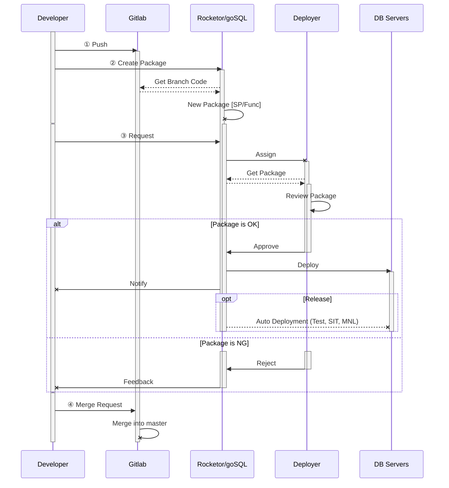
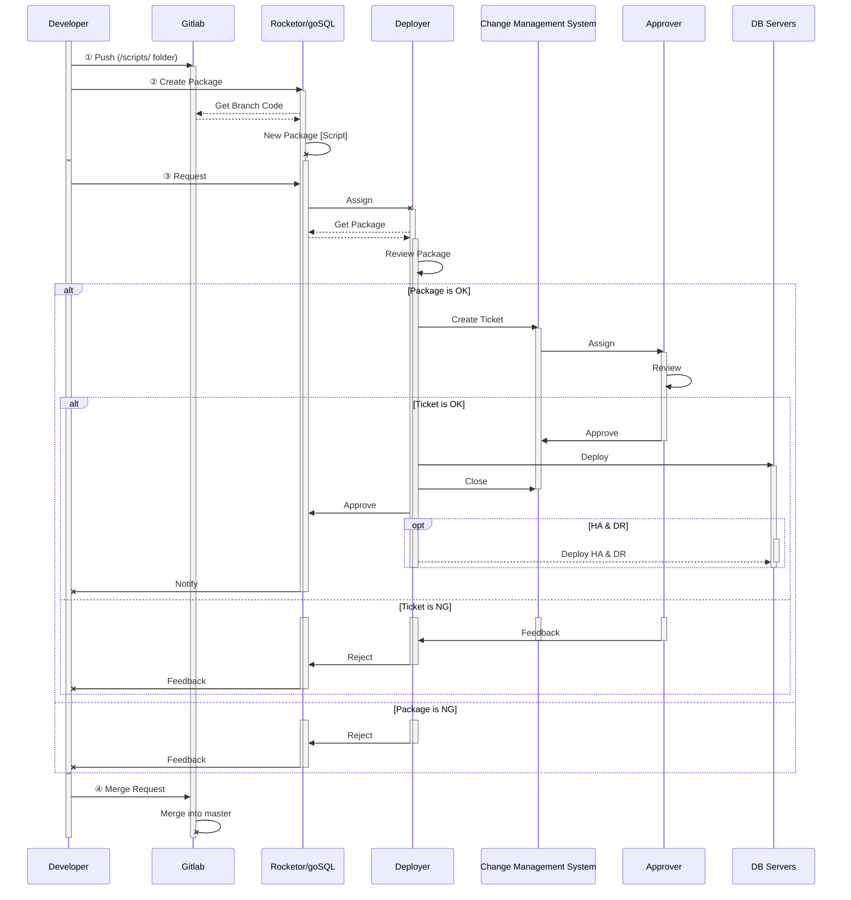

# Deployment Process

## Overview

This deployment process is for developers and deployers to communicate with each others for deployment tasks. The process utilizes the Rocketor/goSQL tool (which developed by NexOps team) to reduce human actions and increase productivity by applying automation at some steps.

This deployment process **MUST be applied** at all times. The only exception accepted is to solve critical issues on **Production** and have prior **_Supervisor_**'s approval.

All deployments as of now will be handled in these 2 time ranges: [**10:30 AM** to **11:30 AM**] and [**03:30 PM** to **04:30 PM**]. Any requests sent outside the deployment time ranges will be handled in the next deployment time.

> **Important:** Please check your packages carefully before submit deployment request to avoid any delay that may happen because of the feedback after reviewing.

## Process Diagram

The following charts show the detail steps of deployment processes. Currently, we are having the diagram for [stored procedures & functions](#stored-procedures-functions) and [scripts](#scripts) packages. For how-to instructions for developers, please see the [tutorial](#developer-tutorial) section.

### Stored Procedures & Functions

### Scripts

## Tutorial

### Developer Tutorial

| Id | System | Step | Description | Video |
| :----: | :----: | :---- | :---- | :---- |
| 1 | Git | Rebase & Push | |  |
| 2 | goSQL | Create Package | |  |
| 3 | goSQL | New Request | |  |
| 4 | goSQL | Receive Feedback | |  |
