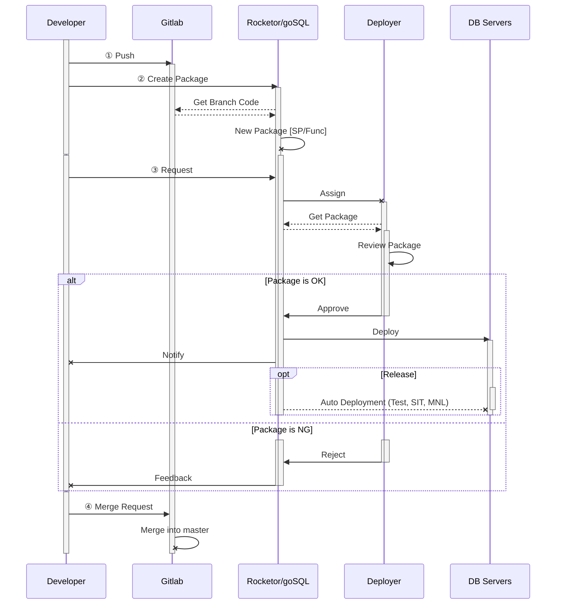
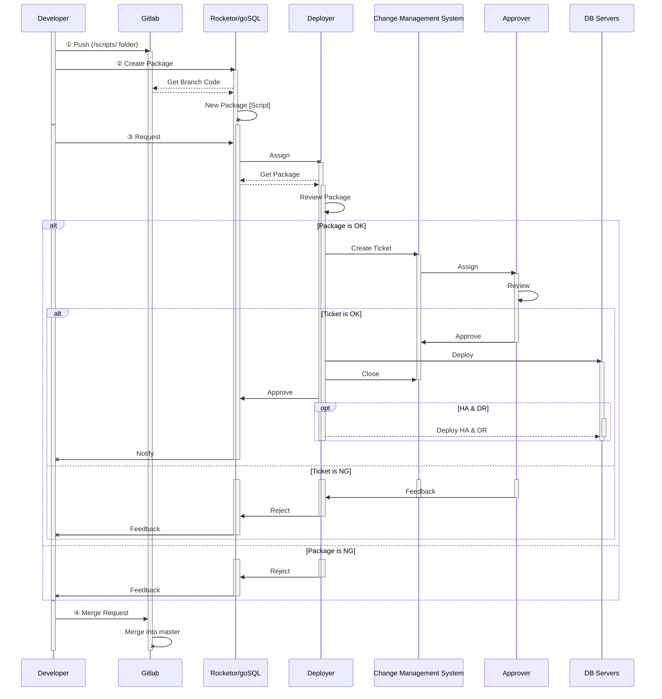

# Deployment Process

## Overview

This deployment process is for developers and deployers to communicate with each others for deployment tasks. The process utilizes the Rocketor/goSQL tool (which developed by NexOps team) to reduce human actions and increase productivity by applying automation at some steps.

This deployment process **MUST be applied** at all times. The only exception accepted is to solve critical issues on **Production** and have prior **_Supervisor_**'s approval.

## Working Convention

### Deployment Time

> All time mentioned in this section is **UTC+7**.

All deployments as of now will be handled in the 2 (two) following deployment sessions. This rule is for all deployment requests on **SIT**, **UAT**, and **PROD** environment.

#### Morning Session

- Session time: **10:00 AM** to **11:00 AM**
- All requests submitted before **10:30 AM** will be processed. Any requests come after this time will be handled in the [Afternoon Session](#afternoon-session).

#### Afternoon Session

- Session time: **03:00 PM** to **04:00 PM**
- All requests submitted before **03:30 PM** will be processed. Any requests come after this time will be handled in the [Morning Session](#morning-session) of the next day.

> **Important:** Please check your packages carefully before submit deployment request to avoid any delay that may happen because of the feedback after reviewing.

#### Deployer's Responsibility

- **_Deployer_** will make sure all valid requests will be reviewed and deployed within current session.
- **_Deployer_** will follow the review checklist for all requests and give feedback to **_Developer_** for any changes needed.
- **_Deployer_** will process the requests in following order:
	- **PROD** environment > **UAT** environment > **SIT** environment
	- First come first served
- **_Deployer_** have to update the processing status to **_Developer_** in any abnormal cases, such as: change deployer, slow review/deploy, etc.

#### Developer's Responsibility

- **_Developer_** will make sure the package and the request are carefully reviewed and tested before submitting.
- **_Developer_** will provide any additional information needed for **_Deployer_** to handle the request as fast as possible.
- **_Developer_** have to acknowledge that any requests came after defined time will **NOT** be processed in the deployment session.

#### Exceptions

**_Deployer_** will process the deployment requests **ONLY in deployment sessions**. But may have exceptions for the following cases:

- The request is associate with a **hotfix** (redmine id has **Hotfix** tracker).
- The request is agreed by related parties to be run at the specified times.
- The request has special approval from **_Supervisor_** to be run outside deployment session.
- The request has to be deployed in **UM Time**. In this case, please refer to [UM Deployment](#um-deployment) section for more information.

In any situation, **_Deployer_** will have the right to reject any requests that are not belong to above exceptions and will process them in the next deployment session.

### UM Deployment

Under Maintenance Session (UM or UM Time) is a planned downtime of the system for administrators to perform any kind of maintenance and deployment tasks. Therefore, all tasks in UM Time have to be carefully prepared beforehand to minimize the system downtime.

For deployment tasks in UM Time, there are rules that need to be followed in order to plan the UM smoothly. The rules are different for different environments.

#### **Production** UM Deployment

All UM deployment tasks **MUST be planned** and request to **_Pontus_** team via [this Google Sheet](https://starixdba.page.link/UMRequest).

**_Pontus_** team will collect all request at **02:00 PM** on the nearest **Friday** before particular UM Time. Any **Script** packages **MUST** be ready at this time for **_Pontus_** team to estimate deployment time correctly.

For **SP/Func** packages, they **MUST** be submitted **before 09:00 AM** on the day of UM.

All requests planned for UM Time must have **UM flag** checked to be distinguished with non-UM packages.

> **Important:** Any packages submitted after defined time may be rejected due to lack of reviewing time.

#### **SIT** UM Deployment

For the moment, the only requests need to be deploy in UM time on **SIT** environment are **Script** packages. They **MUST** be submitted at least *1 (one) day* before announced SIT UM time. In the case no **SIT UM** session announced, **_Pontus_** team will arrange to have the request deployed in the next **SIT UM**.

----

  The following charts show the detail steps of deployment processes. Currently, we are having the diagram for [stored procedures & functions](#stored-procedures-functions) and [scripts](#scripts) packages.  
  For developer's instructions, please see the [developer tutorial](#developer-tutorial) section.  
  For deployer's instructions, please see the [deployer tutorial](#deployer-tutorial) section.

## Process Diagram

### Stored Procedures & Functions

### Scripts

## Tutorial

### Developer Tutorial

#### Git - Rebase & Push

Using _Git Extension_:

1. Issue **_Fetch all_** command to get latest changes on remote repository.
1. If current branch is **NOT** based on `master`:
	1. Issue **_Rebase_** command on `origin/master`
	1. Resolve any conflict if exists.
	1. Issue **_Push_** command with **_Force with lease_** option. (Make sure you don't override any changes of other colleagues before **_force push_**)
	1. Notify related colleagues for the change so they can update their local git repository.
1. Repeat these steps whenever you want to check if your code is updated.

#### goSQL - Create Package

Using **[goSQL Portal](https://rocketor.nexdev.net/goSQL)**

1. On `Dashboard` panel, navigate to your working repository.
1. Click on the **plus** icon on the left of repository name to access **_Create Package_** function.
1. Choose the package type:
	1. **Single Package**: Packages of this type consist of changes in _a single repository_. This type is the most common in our deployment process.
	1. **Mixed Package**: Package of this type consist of changes in _2 repositories_.  
	This type is only for **SP/Func** category.
1. Choose the package category:

	> Any files that are different with `master` branch will be included in the steps below.  
	**Important:** If your branch is not based on `master`, outdated files will also be included in the scan.

	1. **SP/Func**:
		- _goSQL_ will scan all `.sql` files **_outside_** `<root>/Scripts` folder.
		- Only `.sql` files with this line at the top / bottom of the content are included in the package  
		`/*<info serverAlias="DBALIAS-Database" executers="" selectors="" viewers="" isFunction="0" isNested="0"></info>*/`
		- _goSQL_ will also scan for `_UnchangedSPs.txt` file to include the files that have not been changed but need to be included in the package.
	1. **Script**:
		- _goSQL_ will scan all `.sql` files **_inside_** `<root>/Scripts` folder.
		- Only `.sql` files with this line at the top / bottom of the content are included in the package  
		`/*<info serverAlias="DBALIAS-Database"></info>*/`
1. Choose your working branch, then choose the commit that you want to create package from.
1. In the next popup, you can:
	- Change package name
	- Change related Redmine Id
	- Choose to associate the SP list with above Redmine Id or not (this info will be updated to _NDict_ system)
	- Add package note
	- Reorder script in the list (default order is function first, then nested first)

	> **Important:** Scripts will be deployed by the order in the package. Please review the script order carefully to avoid incorrect deployment.

1. Click on **_Create_** to create package, or click on **_Request_** to proceed to request popup (see [Request Deployment](#)).
1. After package creation, you can view it in `Dashboard` panel, under your working repository.

#### goSQL - New Deployment Request

Using **[goSQL Portal](https://rocketor.nexdev.net/goSQL)**

##### Via `Dashboard` panel

1. On [`Dashboard`](https://rocketor.nexdev.net/goSQL/) panel, navigate to your working repository.
1. Click on the **_Request_** button on the environment you want to request the deployment.
1. In the next popup, you can:
	- Select the version of the **SP/Func** package that will be deployed as.
	- Choose the deployer to handle your request.
	- Specify the time that the request will be deployed.
	- Specify if this request need to be handle in UM session or not.
	- Add some notes for deployer so he can process your request more efficient.
1. Click on **_Submit_** button after checking all the info.

##### Via `Request` panel

1. On [`Requests`](https://rocketor.nexdev.net/goSQL/Request) panel, click on **_New Request_** button.
1. Select your package
1. Then, you can:
	- Choose the environment that your request will be deployed to.
	- Select the version of the **SP/Func** package that will be deployed as.
	- Choose the deployer to handle your request.
	- Specify the time that the request will be deployed.
	- Specify if this request need to be handle in UM session or not.
	- Add some notes for deployer so he can process your request more efficient.
1. Click on **_Submit_** button after checking all the info.

##### Via `Package` panel

1. On [`Packages`](https://rocketor.nexdev.net/goSQL/Package) panel, search for the package you want to request deployment.
1. In the result table, on `Request` column, click on the **plus** icon of the package to create new request.
1. In the popup, you can:
	- Choose the environment that your request will be deployed to.
	- Select the version of the **SP/Func** package that will be deployed as.
	- Choose the deployer to handle your request.
	- Specify the time that the request will be deployed.
	- Specify if this request need to be handle in UM session or not.
	- Add some notes for deployer so he can process your request more efficient.
1. Click on **_Submit_** button after checking all the info.

#### goSQL - Tracking Deployment Request

##### Via [`goSQL - Dashboard`](https://rocketor.nexdev.net/goSQL) panel

1. On `Dashboard` panel, navigate to your working repository.
1. Looking for your package to see the status on each environment.
1. The deployment status will be refreshed automatically.

##### Via `Skype`

1. Search for your team deployment room. The room usually has this name: `Devs - <Team Name> - DB DEPLOYMENT`
1. Whenever your request is created, updated, approved or rejected, **Skynex** bot will send related info into the deployment room.
1. You can also work with deployer in the room if needed.

### Deployer Tutorial

_(to be updated)_
